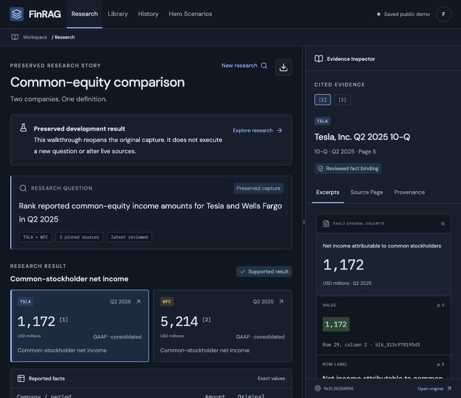
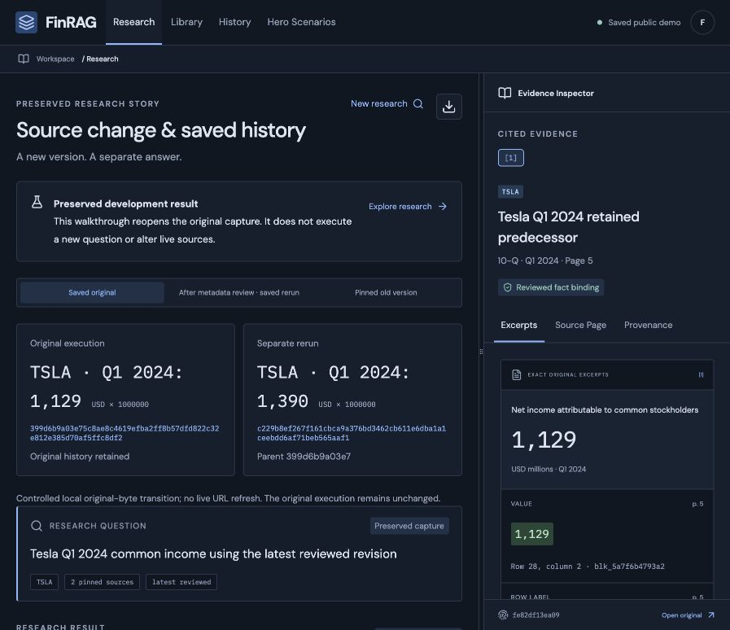

# Fin-RAG-Lab

**Financial research you can trace from an answer to its original evidence.**

Compare company reports, inspect cited facts and calculation operands, understand revisions and evidence gaps, and reopen immutable research. The private development corpus covers Wells Fargo, Tesla and AMD: **22 official originals and 168 named Codex-reviewed fact cards**.

[Open the public demo](https://fin-rag-lab.vercel.app/) · [Research stories](https://fin-rag-lab.vercel.app/?view=heroes) · [Architecture](docs/kb/SYSTEM.md) · [Evaluation evidence](docs/kb/EVALUATION.md#portfolio-benchmark-and-engineering-evidence) · [Documentation index](docs/INDEX.md)

[](https://github.com/daniel-li2021/fin-rag-lab/actions/workflows/ci.yml)
[](LICENSE)
[](https://www.python.org/downloads/)



*Captured from the public Vercel site on October 15, 2026. The comparison reopens a saved development result; it does not run a new question.*

## Public demo and live research

The **Meridian Next.js workspace is deployed on Vercel**. Its public Demo mode serves preserved results without FastAPI, PostgreSQL or paid APIs. “Deployed” describes the website; its research data is a saved archive.

| Capability | Public Vercel demo | Private live research |
| --- | --- | --- |
| Research | Five interactive saved stories plus an AMD calculation receipt | New requests over owner-selected sources, reviewed cards and bounded original-passage search |
| Evidence | Exact saved excerpts, role bindings, provenance and official source links | Pinned originals and source/version/build identities from the owner registry |
| Library | Sources/cards included in the approved captures | Owner corpus, metadata review and ingestion/build coverage |
| History and revisions | Ten saved executions; preserved original/rerun/old-version walkthrough | Immutable saved answers, stale-source detection and explicit parent-linked reruns |
| Access and availability | Public, read-only archive; new research and reruns disabled | Authenticated owner backend, demonstrated locally; cloud activation remains pending |

The public archive contains **11 exact preserved result payloads**; one old-version query was never saved and remains outside History. It excludes full PDFs, rendered report pages, private collections and credentials. Source changes are a labeled saved transition, with no active URL monitoring. [Public deployment receipt](docs/evidence/checks/PUBLIC_DEPLOYMENT_20261014.json).

Live adapters exist per capability, but Render/Neon and fresh cloud AI research have not been activated or validated. [Hosting and progressive activation](docs/kb/RUNTIME.md#public-hosting-and-progressive-activation) documents the owner authentication and activation requirements. Independent financial release validation remains held.

## Research workflow

1. **Choose the question and evidence.** In the private workspace, select a collection or narrow source set and specify company, period, metric, scope and basis. Use Lookup, Compare, Trend, profit margin or operating calculations. In the public demo, select a preserved research story.
2. **Read the outcome and coverage.** Supported facts, missing evidence and clarification stay explicit. An incomplete or incompatible comparison withholds the full ranking or difference while retaining independently supported facts.
3. **Inspect the original support.** Select a value or citation to open the Evidence Inspector. Check the value, row label, column period, unit, scope and basis bindings. Issued calculations retain cited operands and a deterministic Decimal receipt.
4. **Keep the research record.** History reopens the original answer without recomputing it. In the private workspace, an explicit rerun creates a separate result linked to its parent; source edits do not rewrite prior answers.

The [five public stories](https://fin-rag-lab.vercel.app/?view=heroes) demonstrate common-equity ranking, recast-aware research, useful partial answers, period-aware narrative and source change with saved history. Optional narrative drafts retain their **generated, unreviewed** qualification.



*Captured from [the Vercel source-change story](https://fin-rag-lab.vercel.app/?view=research&hero=change&step=0) on October 15, 2026. The controlled cached-byte scenario preserves Tesla's original $1,129m answer and a separate $1,390m rerun; it is not a live URL refresh.*

## Engineering highlights

- **Evidence has durable identity.** PostgreSQL/pgvector stores immutable source versions, build identities and owner-scoped research. Original hashes and reviewed role bindings connect financial facts to their actual source context.
- **Financial arithmetic stays deterministic.** Reviewed cards and Decimal calculations govern numeric answers. Period, fiscal calendar, scope, basis, currency and revision compatibility constrain comparisons; the frontend renders backend results without recalculating them.
- **Retrieval and synthesis have bounds.** Direct Ask uses parent-child retrieval with BM25/RRF. Research uses task-scoped cards and original passages with explicit coverage gaps; optional one-call narrative drafts remain qualified. Reviewed bindings require curation, so this is not automatic financial extraction.
- **Refreshes preserve the last good state.** Leased ingestion and atomic build activation retain searchable evidence after failed work. Immutable history, stale-version detection, explicit reruns and tested backup restore preserve earlier research.
- **Public and private access are enforced on the server.** Per-capability Demo/Live adapters share Meridian views. Live routes require owner authentication before backend access; uploads and administration remain private. Request limits, acquisition deadlines and sanitized failure/usage receipts bound execution.

[System contracts](docs/kb/SYSTEM.md) · [Financial policy](docs/kb/FINANCIAL_POLICY.md) · [Engineering checks and reproduction](docs/kb/EVALUATION.md#portfolio-benchmark-and-engineering-evidence)

## Evaluation evidence

These are retained, dated **development and engineering measurements**, not an independent release accuracy claim. Named Codex review, deterministic executions and saved-draft revalidation have separate meanings.

| Evidence | Recorded result | Boundary |
| --- | --- | --- |
| [Core development review](docs/benchmarks/20261004-authentic-gaps/core/reviewed_summary.json) | 48/48 strict; 25/25 numeric; 13/13 required multi-document; 12/12 supported saved narrative claims | Integrated deterministic regression with saved drafts revalidated after exact parity; named Codex review |
| [Extension](docs/benchmarks/20261004-authentic-gaps/extension/reviewed_summary.json) and [gap cases](docs/benchmarks/20261004-authentic-gaps/gaps-corrected/reviewed_summary.json) | 16/16 and 8/8 strict | Separate development sets; do not enlarge the core or holdout denominator |
| [Final backend validation, October 13](docs/evidence/checks/BACKEND_FINAL_20261013.json) | 179/179 unit tests; 16/16 disposable PostgreSQL checks; 13/13 source-transition checks | Offline/local engineering evidence; one controlled source-transition scenario |
| [Read-only parity benchmark](docs/benchmarks/20261013-backend-final/qualified/summary.json) | 264/264 exact-content matches across 72 distinct development cases | Includes repetitions and eight reused narrative drafts; zero provider calls; no new accuracy cases |
| [Public frontend validation, October 14](docs/evidence/checks/PUBLIC_DEPLOYMENT_20261014.json) | 11 exact payloads; 11 adapter/security checks; 12 desktop and two mobile journeys | Saved public-demo behavior; no cloud live backend or fresh inference validation |

The October 13 benchmark measured warm deterministic **p50/p95 of 8.35/21.76 ms (n=120)** and saved-draft revalidation **53.35/151.78 ms (n=24)** on local macOS ARM64/PostgreSQL. These cached local timings exclude model generation and do not establish sustained capacity or a production SLA.

**Release gates remain held:** independent named financial review and a disjoint sealed holdout are still required. Fresh unseen generation quality, live changed-URL refresh and sustained cloud capacity remain unmeasured. [Evaluation contract and reproduction](docs/kb/EVALUATION.md) · [Canonical current state](docs/STATE.md)

## Run the public demo locally

```sh
cd frontend
npm ci
npm run dev
```

Open [localhost:3000](http://localhost:3000). Demo mode needs no database, backend or provider credentials. The approved captures are included; the full private corpus is not. [Production build and public smoke checks](docs/kb/RUNTIME.md#public-hosting-and-progressive-activation).

## Private research quickstart

For an existing owner setup with retained data:

```sh
pip install -r requirements.txt -r requirements-persistence.txt pgserver==0.1.4
# Supply OPENAI_API_KEY privately in the ignored .env or environment.
python scripts/local_postgres.py start
set -a
source index/product-local/runtime.env
set +a
GENERATOR_MODEL=gpt-6-luna REASONING_EFFORT=none python -m streamlit run app/streamlit_app.py \
  --server.address 127.0.0.1 --server.port 8502
```

This reuses the existing private cluster and source/build identities. A fresh checkout needs acquisition, reviewed window ingestion, original bindings and its own capture manifest; tracked receipts do not distribute ignored originals or database state. Explicit exported settings take precedence over dotenv fallbacks. Follow [local runtime](docs/kb/RUNTIME.md) and [persistence](docs/kb/SYSTEM.md).

Streamlit remains the private administration interface. Keep it on loopback or an authenticated private connection; navigation is not multi-user authorization. The [private API](docs/kb/SYSTEM.md) uses single-owner bearer authentication. New ingestion or generation requires separately authorized provider use; browsing saved results does not rerun research.

## Learning and contributing

Seven [notebooks and the local usage guide](docs/kb/RUNTIME.md#notebook-and-local-compatibility-path) cover parsing, chunking, retrieval, generation and offline evaluation. Without `DATABASE_URL`, Streamlit uses the local Chroma compatibility service; this teaching path is separate from persistent Research.

Start with [docs/INDEX.md](docs/INDEX.md) for current contracts, plans and evidence. Follow [CONTRIBUTING.md](CONTRIBUTING.md) for validation and integration; run `python scripts/check_docs.py` after documentation changes. License: [MIT](LICENSE).
